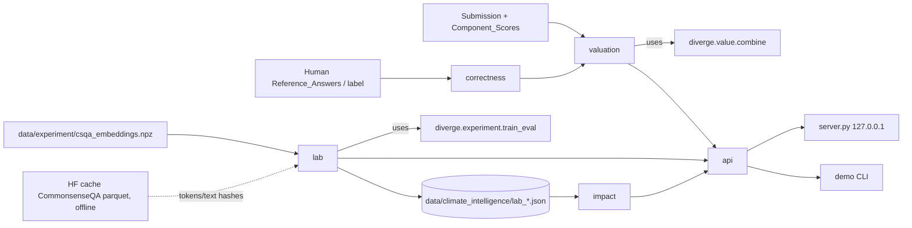

# Design Document: climate-intelligence-engine

## Overview

`climate_intelligence/` is a new, standalone, local-only package that chains four steps, each with explicit status labels and provenance:

1. **Valuation**: separates divergence, reasoning, correctness, Training_Value and Verification_Status. Training_Value comes from `diverge.value.combine` unchanged (cap 25, floor 55).
2. **Lab**: compares `A_random`, `B_novelty_only` and `C_quality_gated_value` under one Token_Budget, using cached CommonsenseQA embeddings. Training goes through `diverge.experiment.train_eval` (imported, not changed).
3. **Impact**: computes energy and CO2e with explicit formulas and conservative status propagation.
4. **API / Demo**: three dict-in/dict-out functions, an optional localhost HTTP wrapper, and a labeled CLI walkthrough.

Design decisions:
- **Reuse, don't fork.** Scoring math stays in `diverge.value`. Training stays in `diverge.experiment.train_eval`. The Lab passes hyper-parameters by setting `diverge.experiment.CONFIG` keys inside a context manager and restoring them in `finally`, so the global config is never changed permanently.
- **Correctness comes only from humans.** `check_correctness` has no baseline parameter. AI baselines reach only `score_submission`, through the Scoring_Adapter.
- **The quality proxy is honest about what it is.** CommonsenseQA has no per-example quality labels. Arm C therefore uses a train-only typicality proxy: cosine similarity to the train-pool centroid, mapped through the same `clip((x-lo)/(hi-lo),0,1)` shape as `diverge.value.quality_gate`. `lo` and `hi` are the 10th and 60th percentiles of train similarity. It never touches eval data. The Lab_Result records it as `quality_proxy: "train_centroid_typicality"` with `is_proxy: true`.
- **Null results get reported.** With 3 seeds, the smallest attainable sign-flip p-value is 2/2³ = 0.25. The Lab_Result states this as `min_attainable_p`, so "no significant difference" is the expected outcome at default settings.
- **No fabricated energy numbers.** macOS has no unprivileged power instrumentation, so `measured_energy_kwh` is null with a reason. The Calculator works only from caller-given power, which is marked as an assumption.

## Architecture



Package layout (all new files):

```
climate_intelligence/
  __init__.py          # VERSION = "cie-0.1-experimental", re-exports API
  status.py            # Measurement_Status order, weakest(), provenance(), CIError
  correctness.py       # check_correctness, validate_reference
  valuation.py         # value(), score_with_models() (Scoring_Adapter)
  lab/
    __init__.py        # run_lab()
    data.py            # load_real(), make_synthetic(), token counts, hashes
    arms.py            # select_random, select_novelty, select_gated, typicality_gate
    leakage.py         # check_leakage()
    stats.py           # summarize(), significance()
  impact.py            # compute_energy(), compare_arms()
  api.py               # value_submission, run_lab, estimate_impact
  schema.py            # load_schema(name), validate(obj, name)
  server.py            # optional http.server wrapper (no auth)
  demo.py              # python -m climate_intelligence.demo [--synthetic]
  schemas/             # *.schema.json (Draft 2020-12)
  examples/            # <fn>_request.json, <fn>_response.json
  README.md
tests/climate_intelligence/
  test_valuation.py test_correctness.py test_lab.py test_leakage.py
  test_impact.py test_api.py test_schemas.py test_properties.py
```

## Components and Interfaces

### status.py
```python
STATUSES = ("measured", "estimated", "hypothetical", "synthetic")  # strongest -> weakest
def weakest(*statuses: str) -> str
def provenance(value, unit: str, status: str, source: str, assumption: bool = False,
               formula: str | None = None) -> dict
class CIError(Exception):  # .code, .message, .field ; .to_dict() -> Error_Object
```

### correctness.py
```python
MATCH_THRESHOLD = 1.0      # exact normalized/alias match; numeric match within rel_tol
NUMERIC_REL_TOL = 0.01
def validate_reference(ref: dict) -> dict          # ValueError naming "source" / "reference_id"
def check_correctness(answer_text: str, references: list | None = None,
                      human_label: str | None = None) -> dict   # Verification_Status
```
- Normalization: lowercase, strip punctuation, collapse whitespace.
- A reference gives either `accepted` (a list of labels/aliases) or `numeric` (`{"value", "rel_tol"}`).
- Match on `accepted`: the normalized answer equals an alias, or contains it as a whole-word span. Confidence is 1.0.
- `rejected` (an optional list of known wrong answers): a match gives `verified_incorrect`.
- A `human_label` in STATUSES of `diverge.value` takes precedence and uses method `human_label`.
- No match, or confidence below threshold, gives `unverified` with a reason.

### valuation.py
```python
IVS_THRESHOLD = 45.0
def value(component_scores: dict, correctness_status: str | None = None, *,
          answer_text: str | None = None, references: list | None = None,
          human_label: str | None = None, config: dict | None = None) -> dict
def score_with_models(question: dict, answer: str, baselines: dict) -> dict  # Component_Scores
```
- `value` validates the four scores itself, raising `ValueError(field)`. It does this before calling `combine`, so the error names the field even for a missing key.
- It takes Correctness_Status from the explicit argument, or else from `check_correctness`.
- Eligibility: `verified_incorrect` → `False`. `unverified` → `"needs_review"`. `verified_correct` → `ivs >= IVS_THRESHOLD`.
- `score_with_models` imports `diverge.models` lazily. On any import or load failure it raises `CIError("models_unavailable")`. Baselines go only to `score_submission`.

### lab/
```python
ARMS = ("A_random", "B_novelty_only", "C_quality_gated_value")
DEFAULT = dict(mode="real", token_budgets=[2000, 8000], seeds=[0, 1, 2], arms=list(ARMS),
               epochs=None)  # None -> diverge.experiment.CONFIG values
def run_lab(config: dict | None = None, out_dir: Path = ROOT/"data/climate_intelligence",
            write: bool = True) -> dict                      # Lab_Result
def load_real() -> Dataset          # sets HF_HUB_OFFLINE=1; CIError("data_unavailable") if npz missing
def make_synthetic(seed: int, n_train=600, n_eval=200, d=32) -> Dataset
def select_random(tokens, budget, seed) -> np.ndarray
def select_novelty(Q, tokens, budget, seed) -> np.ndarray     # farthest-point, budget-fill
def select_gated(Q, tokens, budget, seed) -> np.ndarray       # greedy max(novelty * gate)
def typicality_gate(Q) -> np.ndarray                          # train-only proxy, in [0,1]
def budget_fill(order: Iterable[int], tokens, budget) -> np.ndarray
def check_leakage(train_ids, eval_ids, train_hashes, eval_hashes) -> dict
def significance(rows, a, b) -> list[dict]                    # paired sign-flip, 10k perms, rng 0
```
- `Dataset` is a simple dataclass: `Q, C, y, Vq, Vc, vy, train_ids, eval_ids, train_hashes, eval_hashes, tokens, token_proxy, hash_basis`.
- Token_Count is the whitespace word count of the question plus its 5 choices, with `token_proxy: "whitespace_words_q_plus_choices"`. If the parquet cannot be read offline, the fallback is a constant 1 per example with `token_proxy: "constant_1_fallback"` and `hash_basis: "embedding_bytes"`.
- Budget fill: walk the arm's ranked order and stop at the first example that would exceed the budget. This matches Requirement 4.2.
- `select_gated` uses k-center distance × gate. If the gate is 0, the value is 0 and the example is never chosen ahead of a positive one.
- Only training arrays are passed to `select_*`.
- Per-run row: `arm, budget, seed, selected_tokens, n_selected, optimizer_steps = epochs*ceil(n/batch), train_seconds, train_cpu_seconds, train_flops (estimated), accuracy, acc_above_chance_per_pflop, gpu_hours: null, gpu_hours_reason: "no_gpu", measured_energy_kwh: null, energy_reason`.

### impact.py
```python
def compute_energy(gpu_power_w=None, runtime_hours=None, pue=None, grid_intensity_kg_per_kwh=None,
                   *, assumed_power_w=None, input_status: dict | None = None) -> dict
def compare_arms(lab_result: dict, baseline_arm: str, comparison_arm: str, budget: int,
                 **energy_inputs) -> dict
```
- Formulas: `it_kwh = W*h/1000`, `facility_kwh = it_kwh*PUE`, `kg_co2e = facility_kwh*GI`.
- Output status = `weakest(inputs)`, capped at `estimated` if any input is an assumption, and `synthetic` if any input is synthetic.
- `compare_arms` uses mean `train_seconds/3600` per arm as runtime (status `measured`, or `synthetic`). Differences are comparison minus baseline.
- Every result carries `scope: "measured experiment only; not data-center-wide savings"`. Any `extrapolation` block is tagged `hypothetical`.

### api.py / server.py / demo.py
```python
def value_submission(request: dict) -> dict
def run_lab(request: dict) -> dict
def estimate_impact(request: dict) -> dict
def serve(port: int = 8765, host: str = "127.0.0.1") -> ThreadingHTTPServer  # POST /value, /lab, /impact
```
- Each API function validates the request against its schema, calls the module, and validates the response.
- It catches `CIError` or `ValueError` and returns an Error_Object (`invalid_input` or the module's code). Any other exception becomes `internal_error`.
- `serve` refuses non-loopback hosts. Docs state it has no authentication.
- `demo.main(argv)` prints the four sections in order. Each number goes through `fmt(value, status)`, which renders as `"ESTIMATED 54.3"`. It falls back to synthetic mode with a banner if `--synthetic` is given or the npz is missing.

## Data Models

Schema files live in `climate_intelligence/schemas/` (JSON Schema Draft 2020-12, validated with `jsonschema`):
`valuation_request`, `valuation_result`, `lab_request`, `lab_result`, `impact_request`, `impact_result`, `error`. Each is a `*.schema.json` file.

Valuation_Result:
```json
{"version": "cie-0.1-experimental",
 "semantic_divergence": {"value": 72.0, "status": "estimated", "is_heuristic": true},
 "reasoning_quality":   {"value": 61.0, "status": "estimated", "is_heuristic": true},
 "correctness": "verified_incorrect",
 "training_value": {"value": 25.0, "status": "estimated", "rule_applied": "incorrect_cap",
                    "ivs_version": "ivs-0.1-experimental"},
 "verification_status": {"correctness_status": "verified_incorrect", "method": "reference_match",
                         "reference_id": "q1-ref", "source": "...", "reason": "..."},
 "training_eligible": false,
 "provenance": {"training_value": "diverge.value.combine", "correctness": "human references only"}}
```

Lab_Result (`lab_result.schema.json`, `schema_version: "lab-result-0.1"`):
```json
{"schema_version": "lab-result-0.1", "run_mode": "real|synthetic", "evidence": true,
 "config": {"arms": [], "token_budgets": [], "seeds": [], "model": {"hidden": 256, "epochs": 30,
            "batch_size": 32, "lr": 0.001, "weight_decay": 0.0001}, "token_proxy": "...",
            "quality_proxy": "train_centroid_typicality", "is_proxy": true, "gate_lo": 0.0, "gate_hi": 0.0},
 "environment": {"python": "3.9.6", "platform": "...", "torch": "2.8.0", "device": "cpu"},
 "leakage_check": {"id_overlap": 0, "hash_overlap": 0, "hash_basis": "text_sha256|embedding_bytes", "passed": true},
 "rows": [{"arm": "A_random", "budget": 2000, "seed": 0, "selected_tokens": 1994, "status": "measured"}],
 "summary": [{"arm": "...", "budget": 0, "acc_mean": 0.0, "acc_std": 0.0, "train_s": 0.0}],
 "significance": [{"a": "...", "b": "...", "budget": 0, "diff": 0.0, "p_value": 1.0, "seeds": 3}],
 "min_attainable_p": 0.25, "summary_statement": "no significant difference",
 "warnings": [{"code": "budget_mismatch", "budget": 0, "arms": [], "delta_tokens": 0}],
 "completed_at": "UTC ISO-8601"}
```
In synthetic mode, every row and summary entry has `status: "synthetic"`, and `evidence` is `false`.

Impact result: `{"inputs": {name: Provenance_Record}, "outputs": {"it_kwh"|"facility_kwh"|"kg_co2e": Provenance_Record}, "difference": {...} | null, "scope": "...", "version": "..."}`. Provenance_Record is `{"value", "unit", "status", "source", "assumption", "formula"}`.

Error_Object: `{"error": {"code": "invalid_input|missing_power|models_unavailable|data_unavailable|leakage_detected|internal_error", "message": str, "field": str|null}}`.

Lab files are written to `data/climate_intelligence/lab_<mode>_<YYYYmmddTHHMMSSZ>.json`. They never overwrite an existing file (a `_N` suffix is added on collision). `data/experiment/results.json` is never opened for writing.

## Correctness Properties

*A property is a characteristic or behavior that should hold true across all valid executions of a system-essentially, a formal statement about what the system should do. Properties serve as the bridge between human-readable specifications and machine-verifiable correctness guarantees.*

Several properties were merged during reflection: shape and labels (1.1, 1.3), match and record (2.4, 2.6), status propagation (10.1, 10.2, 10.4), formulas and provenance (9.1–9.3, 9.5), leakage (5.1–5.3), and schema and round-trip (8.2, 8.3).

### Property 1: Valuation shape, labels and model agreement
For any valid Component_Scores (each 0–100) and any Correctness_Status, `value()` returns all five separated fields. `training_value.status` is `"estimated"`, and `training_value.value == diverge.value.combine(...)["ivs"]`.
**Validates: Requirements 1.1, 1.2, 1.3**

### Property 2: Incorrect cap
For any valid Component_Scores, the `verified_incorrect` status yields `training_value ≤ incorrect_cap` and `training_eligible is False`.
**Validates: Requirements 1.4**

### Property 3: Conventional floor
For any valid Component_Scores with `reasoning_quality ≥ floor_quality_threshold` and any `semantic_novelty` in [0, 100], the `verified_correct` status yields `training_value ≥ conventional_floor`.
**Validates: Requirements 1.5**

### Property 4: Unverified handling
For any valid Component_Scores with no references and no human label, `correctness == "unverified"`, `method == "none"`, `training_eligible == "needs_review"`, and the reason mentions the missing human-authored reference.
**Validates: Requirements 1.6, 2.2**

### Property 5: Valuation JSON round trip
For any Valuation_Result `v`, `json.loads(json.dumps(v)) == v`.
**Validates: Requirements 1.7**

### Property 6: Invalid component scores rejected
For any Component_Scores where exactly one field is missing, non-numeric, `bool`, NaN/inf, or outside [0, 100], `value()` raises a ValueError whose message contains that field's name.
**Validates: Requirements 1.8**

### Property 7: Novelty independence
For any inputs and any two `semantic_novelty` values `a` and `b`, the `correctness` and `verification_status` outputs are equal.
**Validates: Requirements 1.9**

### Property 8: Reference matching is decided by references only, and recorded
For any reference list and answer text:
- If the normalized answer matches an `accepted` alias of reference `r`, the result is `verified_correct` with `reference_id == r.reference_id` and `source == r.source`.
- If it matches no alias (and no `rejected` entry), the result is `unverified` with a non-empty reason.
- The result is the same across repeated calls.
**Validates: Requirements 2.1, 2.4, 2.6**

### Property 9: References without source rejected
For any reference dict lacking `source`, `check_correctness` raises a ValueError naming `source`.
**Validates: Requirements 2.3**

### Property 10: Budget fill
For any positive token array, any budget ≤ the pool total, and any arm, `selected_tokens ≤ budget`. Either the next unselected example in the arm's ranked order would exceed the budget, or no examples remain.
**Validates: Requirements 4.2**

### Property 11: Zero-gate examples never preferred
For any embeddings and gate vector, `select_gated` never picks an example with gate 0 while an unselected, budget-fitting example with gate > 0 exists.
**Validates: Requirements 4.4**

### Property 12: Budget mismatch warning
For any set of per-arm selected token totals at a budget, a `budget_mismatch` warning is present exactly when some pairwise difference exceeds the largest single example's Token_Count.
**Validates: Requirements 4.6**

### Property 13: Over-budget rejected
For any pool and any `token_budget > sum(tokens)`, the Lab raises a ValueError naming `token_budget`.
**Validates: Requirements 4.7**

### Property 14: Leakage detection
For any disjoint train and eval id/hash sets, `check_leakage` passes with overlap 0. If `k ≥ 1` shared ids or hashes are injected, it raises `CIError("leakage_detected")`, and the message reports overlap count `k`.
**Validates: Requirements 5.1, 5.2, 5.3**

### Property 15: Selection is eval-independent
For any synthetic dataset, replacing the eval arrays with different random arrays leaves every arm's selected indices unchanged. All indices fall in `[0, n_train)`.
**Validates: Requirements 5.4**

### Property 16: Significance well-formed
For any paired accuracy arrays over `s` seeds, `p_value ∈ [2/2^s, 1]` (with `s` equal to `seeds`), and `diff(a, b) == -diff(b, a)`. `summary_statement == "no significant difference"` exactly when all `p_value ≥ 0.05`.
**Validates: Requirements 6.6, 6.7**

### Property 17: Synthetic tagging and determinism
For any small synthetic config (seeds, budgets), every status in the Lab_Result is `"synthetic"` and `evidence is False`. Running the same config twice gives identical selections and accuracies.
**Validates: Requirements 7.2, 7.5**

### Property 18: Lab_Result schema and round trip
For any synthetic Lab_Result `r`, `r` validates against `lab_result.schema.json` and `json.loads(json.dumps(r)) == r`.
**Validates: Requirements 8.2, 8.3, 8.4**

### Property 19: Energy formulas and provenance
For any valid finite `W ≥ 0`, `h ≥ 0`, `PUE ≥ 1` and `GI ≥ 0`:
- `it_kwh ≈ W*h/1000`, `facility_kwh ≈ it_kwh*PUE` and `kg_co2e ≈ facility_kwh*GI` (rel_tol 1e-9).
- Every input and output has a Provenance_Record, and each output has a `formula`.
- `facility_kwh ≥ it_kwh ≥ 0` and `kg_co2e ≥ 0`.
**Validates: Requirements 9.1, 9.2, 9.3, 9.5, 9.6**

### Property 20: Scenario difference
For any Lab_Result and arm pair, `difference == comparison − baseline` for it_kwh, facility_kwh and kg_co2e. Swapping the arms negates each difference.
**Validates: Requirements 9.4**

### Property 21: Conservative status propagation
For any assignment of statuses and assumption flags to inputs:
- Each output status is the weakest input status.
- An output is never `measured` when any input is an assumption.
- An output is `synthetic` whenever any input is synthetic.
**Validates: Requirements 10.1, 10.2, 10.4**

### Property 22: Calculator input validation
For any one of {`gpu_power_w`, `runtime_hours`, `pue`, `grid_intensity_kg_per_kwh`} set to an invalid value (negative, NaN/inf, non-numeric, or PUE < 1), the result is `CIError(code="invalid_input", field=<that name>)`.
**Validates: Requirements 11.1, 11.2, 11.3, 11.4**

### Property 23: API never raises on bad requests
For any JSON-like dict (generated with `hypothesis` recursive strategies), each API function returns without raising. The return value is either a schema-valid response or an Error_Object valid against `error.schema.json`.
**Validates: Requirements 12.3**

## Error Handling

| Condition | Module behavior | API response |
|---|---|---|
| Bad Component_Score | `ValueError(field)` | `invalid_input`, field set |
| Reference without `source` | `ValueError("source")` | `invalid_input`, field `source` |
| Models cannot load | `CIError("models_unavailable")` | same code |
| npz missing in real mode | `CIError("data_unavailable")` | same code |
| Parquet unreadable offline | fall back to constant tokens + embedding hashes; recorded in config | n/a |
| id/hash overlap | `CIError("leakage_detected")`, count in message | same code |
| Budget > pool | `ValueError("token_budget")` | `invalid_input` |
| Invalid energy input | `CIError("invalid_input", field)` | same |
| No power and no assumed power | `CIError("missing_power")` | same |
| Unexpected exception | propagates | `internal_error` (message only, no traceback) |
| Non-loopback host for server | `ValueError` | n/a |

The CONFIG override in the Lab is restored in `finally`, so a failure mid-run leaves `diverge.experiment.CONFIG` unchanged.

## Testing Strategy

- **Framework:** pytest, using the existing `pytest.ini` (`pythonpath=.`). Tests live in `tests/climate_intelligence/` and need no `__init__.py`. They run offline; the network test blocks `socket.socket.connect` to non-loopback addresses.
- **Property tests:** all in `tests/climate_intelligence/test_properties.py`. The module begins with `hypothesis = pytest.importorskip("hypothesis")`, so it skips when hypothesis is not installed and nothing new must be installed. Each property is one test with `@settings(max_examples=100, deadline=None)`, tagged with a comment such as `# Feature: climate-intelligence-engine, Property 10: Budget fill`. Lab properties (15, 17, 18) use tiny synthetic data (n_train ≤ 200, epochs 2), so 100 examples stay fast.
- **Unit and example tests:**
  - Valuation cases: incorrect-but-novel (capped, ineligible), correct-but-conventional (floored), and unverified (`needs_review`).
  - `check_correctness` has no `baselines` parameter (checked with `inspect.signature`).
  - `diverge.models` is not in `sys.modules` after `value()`. `models_unavailable` is triggered through monkeypatch.
  - `budget_mismatch` fixture.
  - `data_unavailable` with a tmp path. The SHA-256 of `data/experiment/results.json` is identical before and after a run.
  - `missing_power`, the `scope` field, and the `hypothetical` extrapolation label.
  - `internal_error` through monkeypatch.
  - The shipped example requests produce responses that validate against their schemas.
  - The server is started on port 0 on 127.0.0.1 in a thread, POSTed to once, then shut down.
  - Demo `main(["--synthetic"])` stdout: section order, every number prefixed by a label (regex), the contrarian submission excluded, the banner, and the null-result line.
- **Integration (skipped if data is missing):** one real run with 1 seed × 1 budget on `csqa_embeddings.npz` under `HF_HUB_OFFLINE=1`. The Scoring_Adapter test skips if the local models are not cached.
- **Regression:** `tests/test_scoring.py` must still pass. `.venv/bin/python -m diverge.seed` and `streamlit run app.py` are unaffected because no existing file changes.
- **Not testable here:** GPU-hours as `measured` (Requirement 6.2), since there is no CUDA on this machine. The code path exists, and the test asserts the `no_gpu` branch.
